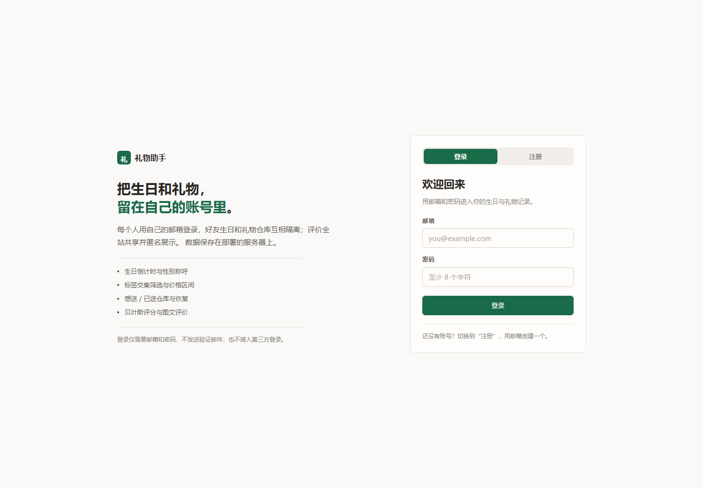

# 🎁 礼物助手 Gift Assistant

> 朋友生日快到了，却总是临时翻聊天记录想送什么？礼物助手把生日提醒、礼物灵感、仓库和真实评价放进一个多账号的小工具里。

非商业个人项目。支持邮箱 + 密码注册登录；好友和仓库按账号隔离，评价与评分全站共享并匿名展示。数据保存在部署服务器的 SQLite 中。



## 账号与登录

- 邮箱 + 密码注册，注册成功后自动登录
- 注册可以配置邀请码：设置环境变量 `INVITE_CODE` 后，注册必须填写正确邀请码
- 密码使用 Node.js `scrypt` 加盐哈希保存，不存明文
- 登录态使用 `HttpOnly` + `SameSite=Lax` 的会话 Cookie，有效期 30 天
- 每个账号的好友、仓库互相隔离；跨账号请求返回 404
- 评价与评分全站共享，评论匿名展示，图片对所有登录用户可见
- 支持在账号设置里修改密码、退出登录、永久注销账号
- 注销账号会删除该账号的好友、仓库、评价、会话和上传图片
- 单用户版本的旧数据，会在**第一个账号注册时**自动归入该账号
- 登录尝试有频率限制；生产环境必须启用 HTTPS，并设置 `COOKIE_SECURE=1`

目前**没有**做邮箱验证、找回密码、第三方登录和昵称/头像。邮箱实际上只作为登录名使用，不会发送验证邮件。

## 功能

### 生日日历

- 手动添加好友姓名、月 / 日、性别，年份可选
- 按距离下一次生日的天数升序排列，今天生日的排在最前
- 生日当天显示“某某某今天生日，快去祝他/她生日快乐吧”，称呼按性别显示
- 好友列表里可以直接补填或调整性别
- 2 月 29 日在平年按 2 月 28 日提醒


### 找礼物

- 关键词搜索：名称、适合人群、推荐理由和标签
- 礼物类型快捷筛选：实用派、仪式感、小众、高性价比、收藏向、陪伴感
- 标签树支持父子层级，可展开 / 折叠
- 多标签交集筛选：同时选“运动”和“足球”只显示同时带有两者的礼物
- 价格区间筛选：0-100 / 100-300 / 300-500 / 500 元以上
- 71 条手工整理的品类礼物，覆盖运动、手办、书籍、香水、实用小物、数码、美食、居家、户外、音乐、手工
- 商品列表行展示 Emoji、名称、参考价区间、结构化文案和标签


### 仓库

- 商品列表行右侧一键收藏
- 区分“想送 / 已送 / 已删除”
- 支持填写购买渠道和实际价格
- 删除为软删除，只写 `deleted_at`，可随时恢复
- 同一账号下，同一件礼物只保留一条有效收藏


### 商品详情与评价

- 商品详情页展示贝叶斯平均分（10 分制，保留一位小数）
- 支持 1-5 星评分、文字评论和图片上传
- 评价列表展示星级、文字、图片和日期
- 评分只在后端计算，前端只负责展示
- 公式：`((C × m + Σ评分) / (C + n)) × 2`，其中 `C = 10`、`m = 3.5`
- 所有账号共享评价与全站评分，评论以“匿名用户”展示
- 图片保存在 `data/uploads/`，登录后由 `/api/uploads/:filename` 读取


## 技术栈

- **Vite 7 + React 19**：前端
- **Node.js `node:sqlite`**：后端与数据库，无需额外数据库服务
- **Node.js `crypto.scrypt` + 服务端会话表**：密码哈希与登录态
- 原生 CSS：无 UI 框架
- 开发模式下由 Vite 同源挂载 `/api`，不需要启动第二个进程
- 生产模式由 `server/index.js` 同时提供静态页面和 API

## 本地运行

需要 Node.js **22.13+**（`node:sqlite` 可用）。

```bash
npm install
npm run dev
```

打开 <http://127.0.0.1:5173>，第一次使用先注册一个账号。

首次启动会自动创建 `data/gift-assistant.db`，建表并写入 71 条种子礼物与 54 个标签。

```bash
# 生产构建 + 启动（默认 http://127.0.0.1:4173）
npm run build
npm start

# 重置数据库（会删除全部账号、好友、仓库、评价与上传图片）
npm run db:reset
```

## 部署到公网

简短回答：

- **只给同一局域网的人看**：不需要买域名或服务器，用 `npm run dev -- --host 0.0.0.0`，别人通过你的局域网 IP 访问。
- **给互联网上任何人看**：需要一台持续运行 Node.js 的服务器或托管平台，并且要有持久磁盘保存 SQLite 和上传图片。域名不是必须的，平台子域名也能用；想要好记的自定义域名才需要每年购买。
- **Vercel / Netlify 这类纯静态或 Serverless 平台不适合直接部署**：文件系统是临时的，SQLite 和 `data/uploads/` 会丢。需要换成带持久卷的 Node 托管，或外部数据库 + 对象存储。
- **登录系统必须走 HTTPS**，否则密码和会话 Cookie 会在网络上明文传输。

完整方案（VPS、PaaS、家庭宽带 + Cloudflare Tunnel、域名、环境变量、备份与安全检查）见 **[DEPLOYMENT.md](DEPLOYMENT.md)**。

## 项目结构

```text
.
├── server/
│   ├── api.js          # 所有 HTTP 接口、鉴权与图片读取
│   ├── auth.js         # 注册、登录、密码哈希与会话
│   ├── db.js           # SQLite 连接、建表与迁移
│   ├── schema.js       # 业务表（含 users / sessions）
│   ├── birthdays.js    # 生日倒计时计算
│   ├── friends.js      # 好友校验与读写（按账号隔离）
│   ├── favorites.js    # 仓库、软删除与恢复（按账号隔离）
│   ├── reviews.js      # 贝叶斯评分、评价与图片保存（按账号隔离）
│   └── seed/           # 种子礼物与标签树
├── src/
│   ├── App.jsx         # 页面、登录界面与交互
│   └── styles.css      # 全部样式
├── docs/               # README 截图
├── data/               # 数据库与上传图片（已 gitignore）
└── index.html
```

## 接口一览

除注册、登录、退出和健康检查外，所有接口都需要登录态。

| 方法 | 路径 | 说明 |
| --- | --- | --- |
| GET | `/api/auth/config` | 公开配置（是否开启邀请码） |
| POST | `/api/auth/register` | 注册：`{ email, password, inviteCode? }`，成功后自动登录 |
| POST | `/api/auth/login` | 登录：`{ email, password }` |
| POST | `/api/auth/logout` | 退出并清除会话 |
| GET | `/api/auth/me` | 当前登录账号 |
| POST | `/api/auth/change-password` | 修改密码：`{ currentPassword, newPassword }` |
| POST | `/api/auth/delete-account` | 注销账号：`{ password }` |
| GET | `/api/gifts` | 礼物与标签数据 |
| GET | `/api/gifts/:id/reviews` | 全站评价列表、贝叶斯得分与星级分布 |
| POST | `/api/gifts/:id/reviews` | 提交评价：`{ rating, comment, image? }` |
| GET | `/api/friends` | 当前账号的好友生日列表 |
| POST | `/api/friends` | 添加好友：`{ name, month, day, gender?, year? }` |
| PATCH | `/api/friends/:id` | 更新好友性别 |
| GET | `/api/favorites` | 当前账号的仓库（有效 + 已删除） |
| POST | `/api/favorites` | 收藏礼物：`{ giftId }` |
| PATCH | `/api/favorites/:id` | 更新状态 / 渠道 / 实际价格 |
| DELETE | `/api/favorites/:id` | 软删除收藏 |
| POST | `/api/favorites/:id/restore` | 恢复已删除的收藏 |
| GET | `/api/uploads/:filename` | 读取共享评价图片（需登录） |
| GET | `/api/health` | 服务健康检查（仅返回礼物/标签数量） |

## 数据与隐私

- 数据库：`data/gift-assistant.db`
- 评价图片：`data/uploads/`
- 账号密码只保存 `scrypt` 哈希；会话只保存 token 的 SHA-256 哈希
- 好友、仓库按 `user_id` 隔离
- 评价与评分全站共享，评论匿名展示；评价图片对所有登录用户可见
- 注销账号会同时删除该账号的数据库记录和上传图片
- 部署在公网时，服务器管理员仍然可以直接读取数据库文件；这不是端到端加密工具
- `data/` 下的数据库与图片已加入 `.gitignore`，不会进入 Git 仓库
- 想清空数据可执行 `npm run db:reset`，或删除 `data/` 目录
- 公开运营前请补充隐私说明与用户协议，并对用户上传的图片做内容管理

## 合规说明

- **不内置任何第三方商品图片**。品类视觉全部使用 Emoji + 色块；README 截图中的图片是本地生成的示意占位图，不是商品实拍图。
- **不抓取任何电商平台数据**。71 条礼物为手工整理的品类参考，不含商家、链接或具体商品 ID。
- **价格仅为品类参考**，例如“比赛级足球：200-400 元”，不是实时售价，也不绑定任何商家。
- **购买渠道由用户自己填写**，应用不推荐具体商家，不做优劣背书。
- **评价只代表用户自己的主观记录**，不构成购买建议。
- 本项目为**非商业性质**，不包含广告、返利、联盟链接或付费功能。
- 截图中的邮箱、好友姓名、生日、渠道和评价均为虚构演示数据，不包含真实个人信息。

## Roadmap

当前版本刻意没有做以下功能：

- 邮箱验证、找回密码
- 昵称 / 头像与评价管理（当前评价匿名展示）
- 邀请码管理后台（当前通过 `INVITE_CODE` 环境变量配置）
- 账号数据导出
- 视频评论、表情包 / 贴纸
- 评论回复与点赞
- 共享礼物清单、多人协作
- 生日提醒推送（系统通知 / 邮件）
- 已送礼物统计与礼物计划导出
- 更多排序方式（价格、随机灵感）与深色模式
- 移动端原生 App

## GitHub 发布

```bash
git init -b main
git add .
git commit -m "feat: 礼物助手 v0.3.0 账号与共享评价"
git remote add origin <your-repository-url>
git push -u origin main
```

`.gitignore` 已包含：

```text
node_modules/
dist/
data/*.db
data/*.db-shm
data/*.db-wal
data/uploads/
```

生产部署需要设置的变量见 [DEPLOYMENT.md](DEPLOYMENT.md)，项目本身不包含密钥文件。

## 许可

本项目为非商业个人项目，默认保留所有权利。若需转载、二次分发或商用，请先联系作者。
